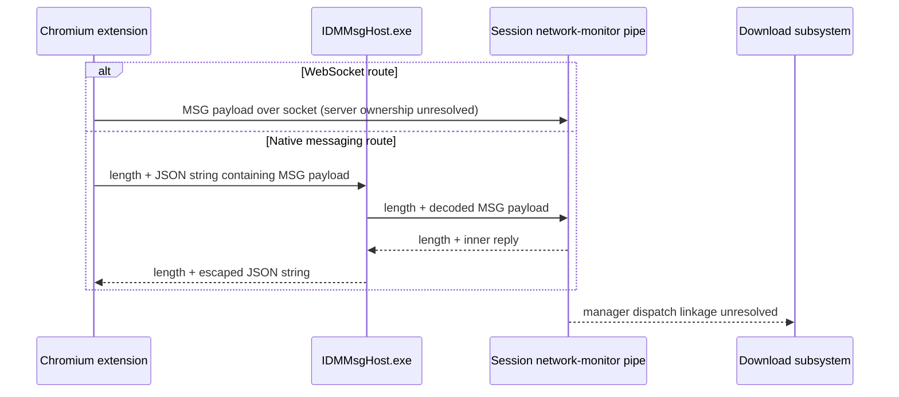

# IDM investigation and Rust reconstruction specification

Investigation date: 2026-10-18. Target: installed IDM `6, 42, 61, 3`, x86 Windows. This is a bounded investigation, not recovered original source or complete IDM compatibility.

## Evidence and deliverables

- [Artifact inventory](../analysis/idm/artifacts.json): installed paths, versions, sizes and SHA-256 hashes.
- [Finding ledger](../analysis/idm/finding-ledger.json): questions, evidence IDs, locations, conclusions and unknowns.
- [Browser protocol](idm-browser-protocol.md): extension inventory, source hashes, message grammar, field mappings and event trace.
- [Runtime results](idm-runtime-results.md): request matrix, concurrency intervals, output hashes and measurement limits.
- [Evidence index](../analysis/idm/evidence-index.json): reproducible file identities and retained REA bundles/snapshots.
- [Approved plan](superpowers/plans/2026-10-18-idm-investigation.md).

**Evidence classes:** static means bytes/code were inspected; runtime means endpoint/file/process observations; user-reported means an action or UI message was reported by the user; proposed means a deliberate Rust design choice. They are not interchangeable.

REA/Ghidra 12.1.4 analyzed the engine and native host. The engine SHA-256 is `c7c80b420579d774f445b6b3f9282c0850760ef790373c0ece0f856a0a05d1d5`; the host SHA-256 is `dba25a49adb88f675db26d2dc7a0fa9d4a5db2326858cb9d2515f6f34b8e0b65`. Original names and types are generally unavailable. Decompiled `.c` files are non-compilable analysis output, not original source.

## Download engine: observations and boundaries

Follow-up: [the segmentation trace](idm-segmentation.md) now identifies candidate selection, a common half-split branch, donor endpoint updates, alternative connection attachment and conditional overlap construction. The table below retains the earlier pass's coverage; the follow-up narrows its segmentation unknowns without claiming a complete scheduler recovery.

Next follow-up: [overlap validation and mismatch recovery](idm-overlap-validation.md) traces two byte comparators and the separate single-connection/restart warning paths. Its coverage and unresolved sample/counter initialization are recorded separately from the earlier runtime tests.

Further follow-up: [sample loading and counter initialization](idm-sample-state.md) traces the local-file tail read, length clamp, receive-count reset and session-construction counter initialization. It distinguishes a separate descriptor field at the same offset.

Final follow-ups: [session lifetime](idm-session-lifetime.md) establishes fresh HTTP-session ownership and reconstruction on a traced outer retry; [scheduler limits and retry paths](idm-scheduler-retry.md) establishes request-rule limits, computed targets, staged expansion, limiter interaction and selected timeout behavior. These close the requested bounded follow-up investigation. The earlier table records initial-pass coverage; the linked reports narrow those unknowns. Remaining gaps are explicit and no Rust implementation is included.

| Question | Established evidence | Status and limits |
| --- | --- | --- |
| How are byte requests constructed? | `FUN_00589430` builds HTTP requests with bounded/open-ended Range forms and reaches `WS2_32::send`; it is called by `FUN_005abda0`. User-assisted tests produced concurrent `206` ranges and narrowing ranges. | Partially answered. Native object offsets are unnamed; exact partition selection/reassignment algorithm remains unresolved. |
| How are responses interpreted? | `FUN_0058a880` branches on Content-Range, Transfer-Encoding, Content-Encoding, Location, ETag and Last-Modified. Content-Range parsing extracts numeric fields. | Static parser recovered. This does not prove every malformed response or redirect policy is safe. |
| What prevents unsafe resume? | The mutable test resumed after both content and validators changed. The user reported a mismatch/restart warning; output matched replacement v2. Requests included overlapping ranges and no logged If-Range/If-Match/If-Unmodified-Since. | Runtime mismatch detection/recovery observed for this fixture. Cannot isolate whether changed validators, overlap comparison, or another condition triggered recovery. |
| Does an If-Range string prove outgoing validator use? | `FUN_005d99a0` recognizes request-context headers and filters If-Range, If-Match and other headers. | No. This occurrence is an incoming-header filter; it is not evidence of outgoing conditional-range construction. |
| What survives pause/restart? | User paused slow.bin, exited/reopened IDM and resumed it. Process changed from PID 19388 to PID 37504; final 16 MiB file matched v1. | Resume across an application restart supported. Exact checkpoint serialization, atomicity and which bytes were reused remain unresolved. |
| Where is persistence represented? | `FUN_0046e6e0` queries TempPath and constructs DwnlData/user paths; `FUN_0049d300` writes Queue under HKCU Software/DownloadManager/Queue. | Static paths and registry writes observed. No private download-history contents were collected and no test checkpoint file was unambiguously identified. |
| How is throttling saved? | `FUN_005b7ef0` writes/deletes bUseSpeedLimiter and psnSpeedLimit using the object's registry handle. User exercised a per-download 128 KB/s setting, then disabled it. | Persistence code and manual control exercised. Exact limiter algorithm, units and achieved rate were not measured. |
| What controls job/connection concurrency? | Queue metadata write recovered; user created RustyIDMTest with one simultaneous job. Logs contain parallel requests inside individual downloads. | Global limits, per-server precedence and scheduler interaction remain unresolved. A request-overlap count is not a configured connection limit. |
| How are failures retried? | Interrupted and temporary-503 test downloads ultimately matched expected bytes. User was instructed to retry the temporary-error prompt once. | Recovery supported; automatic retry policy/backoff cannot be separated from browser and manual retries in this run. |

### Native trace locations

| Function | Evidence ID | Saved analysis |
| --- | --- | --- |
| `0x589430`, HTTP request construction | `ev_d7aca5af011cb3debb8cba2457f8315b6bec33bb7a174c06c1a7d9c924b5c566` | `analysis/idm/native/0x589430.c` |
| `0x58a880`, response header parsing | `ev_6a698bc609ab4404ddaa417540036e53334d5c3c707a261178074fa8829e521f` | `analysis/idm/native/0x58a880.c` |
| `0x5d99a0`, incoming header handling | `ev_73fc19b173c0231cbf94b2358541fe8865f5abe6ccbd11126f61dfb4a4182987` | `analysis/idm/native/0x5d99a0.c` |
| `0x46e6e0`, temporary path handling | `ev_6667a925440caa2f9e8fc26803a3d403d92654f2bae6da9de2dbdd2741d23951` | `analysis/idm/native/0x46e6e0.c` |
| `0x49d300`, queue registry write | `ev_4260206edd9526ef507ad37671e34e2015d66acbe5be12a6d75a7d59df5f4da6` | `analysis/idm/native/0x49d300.c` |
| `0x5b7ef0`, limiter setting write/delete | `ev_72edfd2acc00b355adedd60e01c6155a077aca40ecf60dd5456c202d9c02571b` | `analysis/idm/native/0x5b7ef0.c` |

The corruption-warning string's xref resolves to `0x4ec5c0`, a large translation/string initialization routine. It is **not** the mismatch decision function; no such decision function was recovered here. The header-parser dossier exceeded MCP transport size and was read from retained evidence instead of rerun. Full dossier and limitations remain in `engine-evidence.json`.

## Browser and native host integration

The selected shipped Chromium package is MV3 IDM Integration Module 6.42.60. Static JavaScript tries WebSocket endpoints before falling back to `connectNative("com.tonec.idm")`. Both routes carry a custom `MSG#...` inner protocol. Source maps URL, referrer, cookies, filename, request/response headers and selected body metadata to numeric fields; details and route-specific ambiguity are in the browser report.

The user confirmed IDM took over a download in a disposable Edge profile. The 1 MiB browser.bin output matched the fixture. Endpoint requests carried an Edge User-Agent; this alone cannot distinguish browser requests from IDM reusing browser context. The active WebSocket/native route and raw host messages were not captured. A listener on 127.0.0.1:1001 was observed with owner PID 4; it is not evidence that IDMan.exe itself owns that listener.

### Host bridge recovered statically

- `FUN_00402830` gets stdin/stdout, obtains a session ID, and opens `\\.\pipe\IDMNetworkMonitor.<session-id>` for read/write. It services two directions using events, semaphores and worker threads.
- Browser input is a four-byte length-prefixed quoted string. The host removes quotes, processes escapes through `FUN_00402550`, and forwards a four-byte-length record containing the decoded inner message. Its buffer-offset adjustments must not be mistaken for an identical JSON envelope downstream.
- In the reverse direction, it reserves a quote byte, escapes the message through `FUN_00402420`, adds surrounding quotes and writes the browser length-prefixed string. The 32-bit loads/stores on this x86 target establish little-endian prefix handling for the inspected path.
- `FUN_00403530` constructs a separate initial record beginning `MSG#0#17#1#0:9:` followed by a process ID and `;`. It queries pipe peer process IDs when available. This is distinct from the extension's type-2 handshake.
- `FUN_00403750` can invoke COM with `idmcmd://startnetmon/` on a startup path. The ultimate pipe server and complete manager-side dispatch were not decompiled.
- Explicit errors include failure to obtain session ID, stdio, pipe, events, semaphores, threads, and read/write completion. This is not a complete error-contract recovery.

Host evidence: main `ev_a0f115b1e65bb889cc2727d8657bc1ec542fee061f5f98fd87480246adbee8b3`; escape `ev_390e407cd3fdc26bc456280b61d084916ce3d4b2da032ddcfd41170281ecc730`; unescape `ev_929465caf2dad0f41caeed7882c2f75da87d1b26a2f007f3a3af096bcffdb6cc`; initial record `ev_864c4fcc246ee1eaf48477b482d3ef3575e93308db3594f9bad33b0fc4f2d922`; COM startup `ev_cc891bc113a3842ff5a7a9de7cc10618c7623af8a5b9c084d3d7ceab54b7c24b`. Saved files are `analysis/idm/native/host-*.c`; complete records are in `host-evidence.json`.



The diagram's pipe participant also represents the unresolved server boundary; it does not establish that the WebSocket endpoint and named pipe share a server implementation.

## Runtime results and interpretation

All retained completed test files are checked against the fixture generator at their actual lengths. See the generated runtime report for exact hashes and request counts. User actions are separately retained in `analysis/idm/runtime/user-observations.json`.

- Range-capable initial download: completed correctly at the entered size of 1,677,721 bytes; overlapping requests and additional smaller ranges were observed. It was not the originally requested 16 MiB URL.
- Browser handoff: completed 1 MiB file, user-confirmed takeover. No raw protocol capture or proof of selected transport.
- Unsupported ranges: ignore.bin completed, but this server advertises `Accept-Ranges: none` and IDM sent no range in the observed test. A server falsely advertising range support and returning 200 to a nonzero range is **not tested**.
- Unknown length: unknown.bin completed using a connection-close response without Content-Length. A Range request also received 200 in this case; behavior for a known-size lying server remains separate.
- Redirect: a 302 led to the ranges endpoint and a completed `ranges_2.bin` file. Cookies/authentication across different origins were not tested.
- Interrupted transfer and temporary 503: outputs completed with expected hashes. Browser/manual activity prevents claiming an exact autonomous retry interval.
- Changed content: v1 was paused, v2 was served at the same URL, the user reported mismatch/restart, and the final mutable.bin matched v2.
- Restart: slow.bin resumed after user-performed exit/reopen and completed with the correct hash. Persisted internal layout is unknown.
- Limiter: manual setting and restoration reported. Server write completion includes buffering, so exact 128 KB/s enforcement is not established.
- Queue: user reported a one-job RustyIDMTest run. The first log snapshot contained only queue-b; a follow-up requested queue-a. Treat this as completion testing of queued jobs, **not proof of automatic one-job scheduling with two jobs ready together**.

The payload repeats every 256 bytes. Matching SHA-256 proves equality with this fixture, but this test family cannot expose every incorrect permutation at 256-byte boundaries. A future implementation acceptance suite must add deterministic position-dependent/randomized bytes.

Cookie-bearing context reached the endpoint in later browser tests. Raw values were removed from retained logs; only presence remains. No private browser cookie store was inspected. This presence does not establish exactly which extension/host route supplied it.

## Proposed independent Rust design

These are new implementation choices, not recovered IDM types or defaults. No Rust product code is included in this investigation.

| Boundary | Responsibility and minimum interface |
| --- | --- |
| Transfer engine | `start(request, checkpoint?) -> job_id`; streams HTTP/HTTPS, redirects, response metadata and progress; accepts pause/resume/cancel commands. |
| Segment scheduler | Plans non-overlapping half-open byte intervals `[start,end)` and tracks durable bytes per interval; bounds active segments and global/per-origin transfers. |
| Job controller | States `Queued, Running, Pausing, Paused, Completed, Failed, Cancelled`; completion requires successful finalization, not merely bytes received. |
| Persistence | Saves a versioned job manifest with request identity, destination, partial-file identity, server validators, known total and durable segment checkpoints. Recover interrupted Running/Pausing jobs as Paused. |
| Throttling/retry | Shared rate budget independent of segment count; bounded transient-error retry with cancellation-aware backoff. Configuration is explicit rather than copied from observed IDM request counts. |
| Browser bridge | Original versioned JSON messages through a native host, with explicit acceptance acknowledgment before the extension cancels its own download. No dependency on IDM's MSG IDs, pipe, socket or registry. |

### Minimum types and browser contract

```text
DownloadRequest { url, destination, request_context? }
RequestContext { referrer?, user_agent?, headers, cookies? }
ProgressEvent { job_id, state, durable_bytes, total_bytes?, bytes_per_second, eta_seconds? }
Checkpoint { schema_version: 1, job_id, request, partial_path, total_bytes?,
             strong_etag?, last_modified?, segments: [start, end_exclusive, durable_bytes] }
BrowserSubmit { version: 1, request_id, action: "download", url, suggested_filename?, context? }
BrowserReply { version: 1, request_id, accepted, job_id?, error? }
```

The bridge derives the destination from an application-configured download directory and a sanitized filename; a web page cannot choose an arbitrary filesystem path. Keep sensitive request context local to the job and redact it from logs. Reject unsupported versions/actions and malformed or oversized messages; retain browser fallback when acceptance fails.

Resume policy: require a matching strong ETag for segmented continuation; otherwise restart safely. Last-Modified is retained as metadata but is not sufficient by itself to prove byte identity. Require correct 206/Content-Range for every range. On 200 for a nonzero range, stop sibling transfers and restart as one stream in a fresh partial file. Support unknown-length bodies as one stream. Request identity encoding for segmented transfers so offsets refer to persisted representation bytes. Persist checkpoints only after associated writes are durable; finalize by rename after coverage and length checks. These requirements intentionally do not reproduce unverified IDM behavior.

### Implementation order and acceptance tests

1. Single stream and progress: hashes for fixed/unknown length, redirects, disconnects, cancellation and output errors.
2. Durable resume: process-kill recovery, changed ETag/content, missing validator, truncated partial file, and 200/416 fallback. Verify restart does not append a whole body to existing bytes.
3. Segmentation: valid/malformed Content-Range, ignored ranges despite advertised support, position-dependent payloads, gaps/overlaps and final hash; enforce bounded concurrency.
4. Queues, retries and limits: deterministic local-time tests for one/two ready jobs, global/per-origin caps, retry exhaustion and aggregate byte-rate limits across segments. Revisit the current queue/throttle measurement gaps.
5. Browser integration: original protocol encode/decode/size tests, accepted/rejected handoff, malformed messages, synthetic headers/cookies and browser fallback when the host is unavailable.

## Reproduction, cleanup and open work

Fixture and analysis scripts use Python's standard library. Run `python analysis/idm/runtime/fixture.py`, then follow the saved test procedures; `check_fixture.py` checks the endpoint itself and must not be represented as IDM testing. Failure injection is first-attempt-only per URL path/method: restart the fixture before repeating the self-check suite, and use a fresh path such as `/run-unique/interrupt.bin` for each manual failure experiment. The browser/CLI helpers now generate unique path prefixes, so self-checks or earlier attempts cannot silently consume their failure injection. Existing recorded browser-case paths were separate from self-check paths. These helper changes occurred after measurement; recorded behavior is established by the saved logs, not an assumption that all current tooling bytes were executed. `summarize.py` recreates the runtime report without contacting IDM. `run_cli.py` records submissions through [IDM's documented command line](https://www.internetdownloadmanager.com/support/command_line.html); both submitted attempts produced no observed output/request during their observation windows, so they are not counted as successful tests.

The loopback fixture was restarted after its tool-managed process ended between turns; `fixture-lifecycle.jsonl` records the restart. Request IDs continue above existing logs. The native analysis session also ended between turns; the small host analysis was reopened. Engine evidence had already been exported; extension source and REA summary were saved, but the full worker-session JavaScript parent record was not exported. Both final native sessions were closed with snapshots.

No Rust build or application dev server was run. No normal browser profile was configured by the scripts. The disposable Edge profile is excluded from source control; it and test downloads remain available locally. The user reported turning off the per-download limiter; only the temporary test queue was requested. Ordinary queues and global settings were not changed by investigation scripts.

Open work: full segment-allocation/reassignment and retry algorithms; exact checkpoint format; malformed-response and cross-origin policies; manager-side pipe dispatch; host-origin validation; runtime transport/frame capture; measured throttle rate; and a clean two-ready-job scheduler experiment. These gaps do not prevent implementing the independent Rust contracts above, but they prevent claims of complete IDM equivalence.
