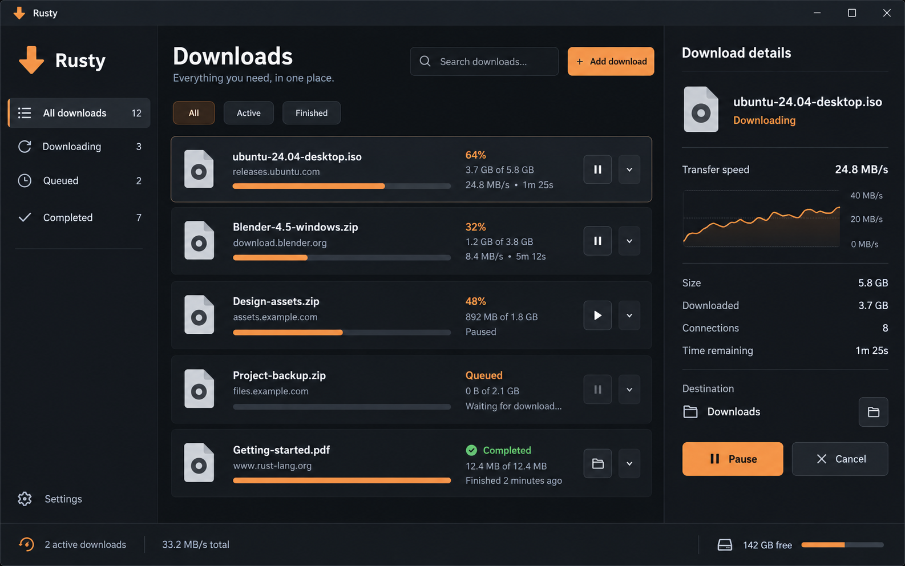

# Rusty desktop download manager design

Status: superseded by [the native Win32 design](2026-10-18-rusty-win32-design.md). The user selected actual OS controls and the IDM-style layout instead of egui and the dark-orange mockup. Retained below as historical design context; implementation not started.

## Intent and agreed direction

Build an independent Windows-first download manager in Rust with a modern graphical interface from the first working version. The user selected egui with eframe and accepted using the generated dark mockup as the visual target. No CLI-first prerequisite. Existing IDM investigation informs transfer behavior; the application will not require IDM or use its private storage/protocol.

Agreed: Rust, egui + eframe, modern desktop GUI, dark mockup as visual target. The scope details and defaults below are the assistant's proposed choices, not previously approved user requirements.

The image is a visual reference with illustrative data. Counts and speed figures must come from actual application state. It is not a screenshot of implemented features. Match the composition, hierarchy and palette; icon artwork and exact spacing are left to the builder.

## Interface

Use a standard OS window frame, charcoal surfaces, warm orange primary actions, readable text, restrained dividers and clear keyboard focus. Avoid decorative effects that obscure download information. At approximately 1280×800, show a left navigation sidebar, a central scrollable list and a right details panel. At narrower widths, collapse details into a selectable view so controls remain usable. A minimum supported window size can be chosen by the builder.

- Sidebar: All downloads, Downloading, Completed and Settings. Add Queued and Paused with the corresponding engine capabilities in later milestones.
- Toolbar: Downloads heading, search input and Add download button. Filter by actual state and filename; no sample records in normal operation.
- Rows: filename, source host, state, received size, total when known, progress and contextual controls. Unknown total uses an indeterminate presentation and omits percentage/ETA. Errors remain readable and actionable. Selecting a row opens its details.
- Details: source URL, destination, transferred/total bytes, speed and remaining time when meaningful; a small speed-history graph; controls for the supported state. Connection count is initially 1 while transferring. Unsupported operations are absent instead of pretending to work.
- Status strip: actual active-download count and aggregate speed. Disk-free space may be omitted until a reliable destination-specific measurement is available.
- Add download dialog: HTTP/HTTPS URL, destination chooser, editable filename, Start and Cancel. Validate input locally and show errors inline. Confirm replacement of an existing destination explicitly; never silently overwrite it.
- Settings in the first version: default destination directory. Persist that setting in the user's application-data directory. Later milestones add connections, queue limits and speed limits.

Builder chooses exact fonts, icons and responsive measurements, using local/bundled assets with appropriate licenses. Avoid copying IDM artwork. Keyboard navigation, visible focus, labeled icon actions, readable contrast and DPI scaling are required design goals; screen-reader support must be verified before being claimed.

## First working version: GUI and single-stream transfers

The first milestone is a working GUI connected to a real single-stream engine. It can add HTTP/HTTPS downloads, show accurate progress, cancel, report errors, and open a completed file or its containing folder. Multiple submissions may run concurrently with a conservative fixed maximum of two; additional submissions show Waiting until a slot becomes available. This simple local admission rule does not include editable named queues or scheduler parity.

Use states Waiting, Running, Cancelling, Completed, Failed and Cancelled. Pause/resume and automatic network retries arrive in the next milestone; the mockup's pause controls are replaced with Cancel until that capability works. Failed jobs offer Retry, which starts from the beginning after explicit user action. Normal operation must not display invented progress, connection counts or completion states.

Write to a unique partial file next to the destination and finalize only on successful response completion, validated length when available, file flush and successful rename. Handle redirects with a finite limit, HTTP failures, unknown-length bodies, network failure and destination errors. Protect existing destination/partial files against name collisions. No media extraction, browser cookie import or browser takeover in this milestone.

For this milestone, the download list is held in memory; persist only the default destination. Closing with active or waiting jobs prompts the user to confirm stopping them, cancels and joins transfer tasks, then exits. No tray/background behavior yet. Cancelled/failed partial files are removed when possible; cleanup failures are reported and the file path retained in the error. Do not imply checkpoint recovery across restart until milestone 2. Transfer threads/tasks must not outlive normal application shutdown.

## Architecture

Use a Cargo workspace with a GUI application and a reusable engine library. The engine owns networking, output files, job state and admission control. The GUI owns view state, selection, search, dialogs and display formatting. UI input sends explicit engine commands; the engine sends job-state/progress events through bounded channels. Disk/network operations never run synchronously in the egui drawing callback. Coalesce progress updates to avoid flooding the UI, and request repaints when state changes instead of relying on a permanent busy redraw loop.

Proposed dependencies: egui/eframe for UI, Tokio for asynchronous execution, reqwest for HTTP and TLS, a native file-dialog helper, and serde for versioned settings. Use compatible stable releases when planning implementation. Exact crate versions, HTTP TLS backend, icon package, speed graph implementation and platform opener helper remain builder choices after checking their current APIs and licenses.

Reuse the independent request/job/event concepts in [the investigation specification](../../idm-investigation.md). Adapt field names as needed; do not expose recovered IDM offsets, messages or registry keys in product APIs. Keep sensitive URL/header context out of routine logs. Browser-submitted context is deferred.

## Subsequent milestones

1. GUI plus verified single-stream transfers as scoped above.
2. Verified pause/resume, durable checkpoints and restart recovery, followed by explicit bounded automatic retry policy. Resume only when representation identity and range semantics support safe continuation; otherwise restart safely.
3. Segmentation with validated ranges, coverage tracking, bounded connections and correct finalization.
4. Editable queues/concurrency and shared speed limits; tray/background behavior as a separately specified addition.
5. Chromium integration through an original versioned browser/native-host protocol.

The larger job-state model can expand to Queued, Running, Pausing, Paused, Completed, Failed and Cancelled as persistence/resume are added. Do not duplicate engine state transitions in UI handlers.

## Verification and constraints

The user instructed: no builds or dev server unless specifically requested. No scaffold, dependencies, product code, build or server launch is authorized merely by this design document. Implementation planning must preserve that restriction and explicitly distinguish source-only checks from compilation/runtime verification. When runtime testing is requested, check actual files with deterministic position-dependent fixture bytes; the earlier repeating-byte fixture is insufficient to detect all segment-placement errors.

Milestone acceptance, once execution is authorized: a user can submit a real download through the GUI, see progress without UI blocking, cancel it, receive a useful error on failure, and open a correctly finalized completed file. Existing files remain intact unless replacement was explicitly confirmed. Exercise empty, unknown-length, failed and active states plus shutdown. Test changes at the engine boundary, not UI implementation details. No claim of successful compilation or GUI behavior without actually performing the relevant authorized check.

## Non-goals and unresolved decisions

GUI reconstruction of IDM, private-format compatibility, licensing internals, media extraction, full scheduler parity, browser integration, automatic updates and installers are outside milestone 1. Cross-platform support is a future possibility, not a tested claim.

No outstanding decision prevents planning this proposal. The user should review the assistant-proposed first-version boundaries, especially cancellation before pause/resume, the fixed two-transfer admission limit, in-memory history and exit behavior. Changes to those choices can be incorporated before implementation planning.
