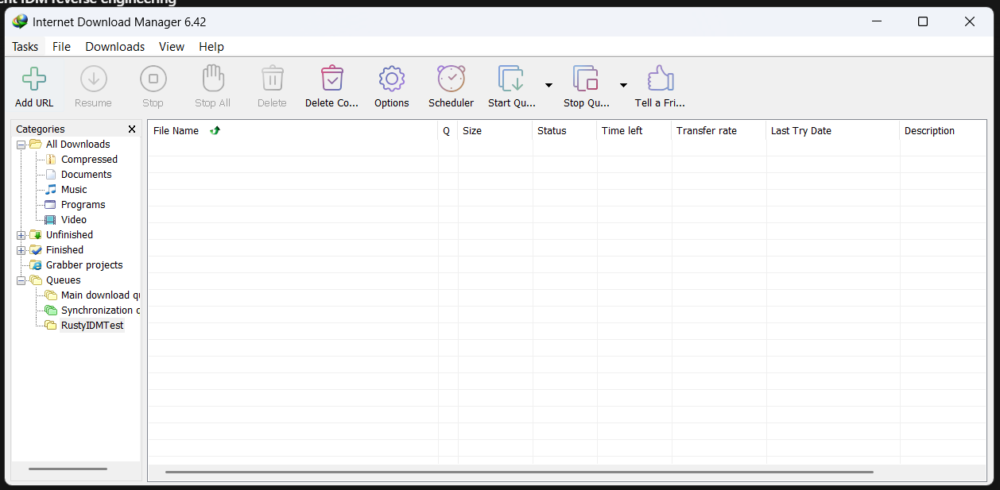

# Rusty native Windows desktop design

Status: native UI direction selected by the user; this document replaces the egui proposal. Product implementation has not started.

## Agreed direction

Rusty will use Rust and actual Win32 controls through Microsoft's `windows` crate. The user supplied the IDM screenshot below as a layout reference and explicitly dropped the orange theme. The goal is a familiar Windows utility: menu bar, toolbar, category tree and a detailed download table. Use the OS control appearance instead of reproducing the earlier dark mockup. No egui, Iced or webview UI.

The screenshot guides layout and interaction. Rusty has its own name and icons; it does not ship IDM branding or private components. The screenshot's queue names and empty download list are example UI state, not data to import. Existing IDM downloads and settings remain untouched.

## Native control layout

| Region | Win32 control / behavior |
| --- | --- |
| Main window | Standard overlapped window, OS title bar and resize borders, title Rusty Download Manager. |
| Menu | Standard menu: Tasks, File, Downloads, View, Help; initially expose only supported commands. |
| Toolbar | Common-controls Toolbar with text labels/tooltips: Add URL, Stop, Stop All, Delete, Options. Enable actions according to selection/state. Resume and queue commands arrive with those capabilities. |
| Left navigation | TreeView under Categories: All Downloads, file-type groups, Unfinished, Finished. Queues appears when configurable queues exist. |
| Main list | Report-mode ListView with native column headers, full-row selection and standard selection colors. Columns: File Name, Size, Status, Time Left, Transfer Rate, Last Try Date, Description. Queue indicator is deferred until queues exist. |
| Footer | Native status bar with actual job count and aggregate transfer rate. |
| Add URL | Native dialog with Edit fields for URL and destination, Browse using the OS file picker, Start and Cancel buttons. |
| Transfer details | Native modeless detail window with labels, Progress Bar, status text and supported action buttons. For unknown size use indeterminate progress and omit percentage/ETA. |
| Options | Native dialog for default save directory; additional settings only as corresponding engine features arrive. |

Progress bars live in the transfer-details window. The main table uses the Status column for progress text; there is no first-version requirement to embed a separate HWND progress bar in each ListView row. This keeps the list native and avoids expensive child-window management while scrolling.

Use Windows visual styles through a Common Controls v6 manifest, system fonts/colors and normal control metrics, with per-monitor DPI awareness. Default appearance is standard light/system-themed Windows controls. Do not promise automatic dark mode or a Windows 11 Fluent appearance from classic Win32 controls. Builder may use simple original icons or suitable system icons; icon artwork need not match IDM. No hard-coded accent palette or custom-painted replacements for standard buttons/progress bars.

Initial size approximately 1250×650 logical pixels, with a roughly 180-pixel navigation pane and the table using remaining space. Measurements are assistant defaults; final metrics should scale with DPI. Handle resizing, column scrolling and long filenames. Native keyboard focus, tab order, menu mnemonics, selection, tooltips and accessible control labels are required. Do not claim verified accessibility before testing.

## First working version

Retain the earlier engine milestone: a real single-stream HTTP/HTTPS downloader controlled through the GUI. Add URL, display accurate progress/errors, cancel one/all active jobs, remove finished/inactive entries, and open completed files or their containing folder. Deleting an entry removes its list record; it does not delete a completed file. Active jobs must finish cancellation before removal. Double-clicking an active row opens transfer details; opening a completed file is an explicit command.

Assistant-proposed initial scope: a fixed admission limit of two simultaneous downloads, with additional submissions Waiting; list/history stays in memory, while the default destination is persisted in user application data. States: Waiting, Running, Cancelling, Completed, Failed, Cancelled. Pause/resume, durable history/checkpoints and named queues are subsequent milestones. Do not display working-looking Resume, Scheduler or browser-capture commands until implemented. The screenshot is not a requirement for full IDM feature parity.

Categories filter actual list entries, using file extensions for Compressed, Documents, Music, Programs and Video. All Downloads includes uncategorized files. Unfinished includes Waiting, Running, Cancelling, Failed and Cancelled; Finished includes Completed. Builder chooses the documented extension mapping. Empty categories are allowed. Search, speed charts and the previous right-hand inspector are deferred.

Start validates URL and destination. Never silently overwrite existing files: prompt for replacement, otherwise allow choosing another name. Use a uniquely reserved partial file beside the destination. Finalize only after successful response completion, length validation when known, flushing and rename; handle final destination races without accidental replacement. Limit redirects and surface HTTP/network/disk errors clearly. Failed retry is explicit and starts from zero in milestone 1. Sensitive request data must not appear in routine logs.

Close with active/waiting jobs prompts to stop them, then cancels and joins engine work before exit. No tray/background operation initially. Remove cancelled/failed partial files when possible; surface cleanup failures and their paths. Restart resume is not available until checkpoint support exists.

## Rust architecture and Win32 responsibilities

Keep a reusable Rust transfer-engine crate separate from the Windows GUI binary. Engine networking and file I/O run on a background Tokio runtime, using a stable HTTP client such as reqwest. UI owns HWNDs, controls, dialogs, selection and list formatting; the UI thread runs the Windows message loop. Never perform network operations, blocking file work or blocking task joins inside a window procedure.

Engine commands/events cross bounded channels. Progress events are coalesced; notify the UI with an application-defined message carrying no temporary Rust references, then drain owned events on the UI thread. Do not send raw pointers to short-lived task state through window messages. Keep HWND/control access on the UI thread; cancellation completion drives asynchronous shutdown. Handle window destruction and late notifications safely.

Use Rust owners for Win32 resources and isolate unsafe FFI, callback dispatch and subclassing. Explicitly handle WM_SIZE, DPI changes, notifications, commands and shutdown. Use Unicode APIs and Windows path semantics. Builder chooses modules, exact dependency versions, manifest/resource tooling and helper abstractions during implementation planning. The engine's independent request/state/progress concepts remain based on [the investigation specification](../../idm-investigation.md), not IDM's private protocols or offsets.

## Milestones and verification

1. Native shell and working single-stream downloads with real progress and cancellation.
2. Verified pause/resume, durable checkpoints and restart recovery, then explicit bounded automatic retries.
3. Safe parallel segments, coverage tracking and bounded connection counts.
4. Named queues, configurable concurrency and shared speed limits.
5. Original Chromium integration; tray/background operation needs its own specified lifecycle.

The user prohibits builds or dev-server launches unless specifically requested. Do not run cargo build, cargo run, cargo test or another compilation-producing command under that restriction. A desktop app needs no application dev server. Plan meaningful engine tests and GUI checks, and run them only when their execution is authorized; source-only checks must be identified as such. Use deterministic position-dependent fixture data for future transfer/segment verification.

Acceptance when runtime validation is authorized: real OS controls render at multiple DPI settings; resize and keyboard operation work; user can submit a download, see accurate progress, cancel, receive useful errors, and open a correctly completed file. Existing files stay intact without explicit replacement. No application code, scaffolding or dependencies have been created by this design change.

## Boundaries

The native control choice and IDM-style layout supersede the earlier egui/dark-orange proposal. First-version concurrency, in-memory history, category mappings and cancellation-before-resume are assistant-proposed scope choices. Full scheduler parity, media extraction, private IDM compatibility, automatic updates, installers and other OS support are deferred. No further reverse-engineering pass is needed before planning this implementation.
